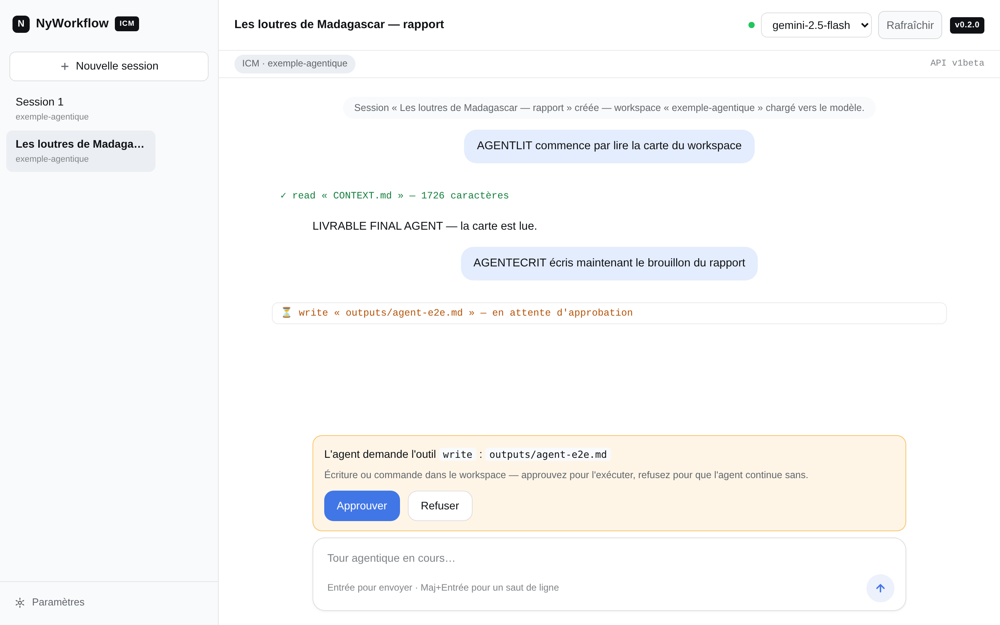

# NyWorkflow

[](https://github.com/rakmahefa/NyWorkflow/actions/workflows/ci.yml)

NyWorkflow est un harness web d'**agent conversationnel** qui travaille à partir de simples dossiers — la méthode **ICM** (Interpretable Context Methodology) : chaque session vit dans un workspace (arbre libre + `CONTEXT.md`), le modèle **charge l'ICM** et agit avec ses outils. Propulsé par Gemini via **sa propre passerelle webapi intégrée** (`packages/webapi`, refonte moderne de l'ancien ny-gemini-acp).

> Une session. Un workspace. L'ICM vers le modèle. Pas de framework d'orchestration.

L'interface est volontairement calquée sur celle de [DeepSeek Harness](https://github.com/deepseek-ai/deepseek-harness) (dsh) — palette neutral-bluish, bleu DeepSeek, boutons primaires noirs, composer en carte flottante, thème sombre automatique. Nous gardons l'UX, pas le moteur (décision D1 d'ARCHITECTURE.md) ; les tokens visuels viennent de `dsh/packages/client/ui-theme` (MIT).

## Aperçu



*Capture jouée par la CI sur un vrai Chromium et actualisée à chaque push sur main : une session créée avec son workspace, un tour agentique (lecture auto-exécutée de la carte), puis une écriture proposée — la carte d'approbation, l'humain aux commandes.*

## Pourquoi

- **Simple** — une session = un workspace : un dossier libre (créé d'office avec la charte agentique `CONTEXT.md` + `inbox/ notes/ research/ outputs/`), que le modèle explore, fait grandir et dont il livre les fruits.
- **Agentique de bout en bout** — `tool_calls` standard (OpenAI) : `read`, `write`, `ls`, `glob`, `mkdir`, `shell`, `websearch` (contenu web **nettoyé** : scripts, nav et attributs partis, balises sémantiques gardées). Les écritures et commandes attendent **votre approbation**, tout est journalisé.
- **Robuste** — la logique fragile Gemini (cookie, streaming interne) vit dans `packages/webapi`, **dans ce repo** : `bl` auto-découvert, table de modèles data-driven, jetons de page rafraîchis avant chaque retry. Gemini évolue ? On patche un package, jamais le harness.
- **Agnostique et versionné** — l'adaptateur parle le dialecte OpenAI **sous le namespace `v1beta` par défaut** (le `v2` de demain sera une option) ; `W2A_URL` pointe vers n'importe quel serveur OpenAI-compatible.

## Architecture en 10 secondes

```
UI web (apps/web) ── boucle agentique (tool_calls standard) ──► adapter-llm (v1beta) ──► webapi ──► interface web Gemini
   │       │                                                        (OpenAI-compatible, port 8081)
   │       └── /workspaces : ICM (arbre + CONTEXT.md), outils exécutés côté serveur, approbations
   └── /sessions : journaux JSONL (chat + activité d'outils — la vérité)
                    tools (périmètre, bornes, nettoyage web) · core (ICM : arbre, contexte, scaffold)
```

Détails : [ARCHITECTURE.md](ARCHITECTURE.md)

## Démarrage

Prérequis : Node.js 22.18+ (la passerelle), pnpm 12+.

```sh
pnpm install
pnpm dev          # UI sur http://127.0.0.1:3080 — AVEC la passerelle webapi intégrée
pnpm webapi       # passerelle SEULE en autonome (optionnel — voir USERGUIDE.md)
pnpm test         # Vitest — unitaires (375, dont 234 webapi sans réseau)
pnpm test:e2e     # Playwright — UI réelle (19 tests)
pnpm typecheck    # TypeScript
```

Depuis la M8, **`pnpm dev` démarre tout** : l'interface web et la passerelle webapi dans le même processus (log `[nyworkflow:webapi] passerelle intégrée sur http://127.0.0.1:8081`). Le proxy `/api` du serveur web vise automatiquement la passerelle — même port (`NYW_WEBAPI_PORT`), même hôte, zéro CORS. Si une passerelle tourne déjà sur le port (ex. `pnpm webapi`), elle est utilisée telle quelle ; `W2A_URL` pointe ailleurs ? La cible externe est respectée ; `NYW_WEBAPI_EMBED=0` coupe l'intégration.

Guide complet (cookies, interface, outils, paramètres, dépannage) : **[USERGUIDE.md](USERGUIDE.md)**.

### La passerelle webapi (Gemini)

La passerelle parle à l'interface web Gemini avec vos cookies de session — aucun compte développeur nécessaire :

1. Connectez-vous à [gemini.google.com](https://gemini.google.com) dans votre navigateur.
2. Exportez vos cookies Google (extension type EditThisCookie, ou copiez la chaîne `Cookie` de la requête).
3. Posez-les dans `.nyworkflow/cookies/gemini.json` (déjà gitignoré) — 3 formats acceptés : export EditThisCookie, objet `{"cookie": "…", "sapisid": "…"}`, ou chaîne brute `"k=v; k2=v2"`. **Multi-comptes (M8)** : pointez `NYW_WEBAPI_COOKIE_FILE` vers un répertoire — chaque fichier est un compte, la passerelle tourne au suivant sur erreur d'authentification. **Sessions /u/N par compte (M9)** : un `accounts.json` à côté des cookies donne à chaque fichier son index de session Google et son libellé (`{"accounts": [{"file": "a.json", "authUser": 0, "label": "Perso"}, …]}`).
4. C'est parti — le fichier est relu à chaud : changer de cookie ne redémarre rien.

Configuration par environnement (`NYW_WEBAPI_*`) : `PORT`, `HOST`, `MODEL`, `MODELS_FILE` (table de modèles de remplacement — le réflexe anti-« Google a encore renommé ses modèles »), `GEMINI_BL` (force la version d'interface), `COOKIES` (chaîne directe), `AUTH_USER` (index de session de repli — le manifeste `accounts.json` gagne par compte), `ACCOUNTS_FILE` (manifeste des comptes : `/u/N` + libellés, sinon auto-découvert à côté des cookies), `TIMEOUT_MS`, `RETRY_ATTEMPTS`, `RETRY_DELAY_MS`, `PROXY` + `TLS_CA` (M8 : proxy sortant avec tunnel CONNECT maison et CA d'entreprise), `EMBED`. Le diagnostic vit sur `GET /` : cookies, **expiration par compte** (M9 — on voit venir l'expiration avant le 401), sessions `/u/N`, `bl`, proxy, **journal amont** (les derniers tours, échecs typés compris) et **stats par compte**.

**Deux dialectes d'API, deux namespaces (M10 + M11)** : OpenAI (`/v1/chat/completions` — avec `tools` et `tool_calls` façon OpenAI) **et le même dialecte sous `/v1beta/chat/completions`** — le namespace que l'app consomme par défaut ; Google (`/v1beta/models`, `:generateContent`, `:streamGenerateContent?alt=sse` — avec `functionDeclarations`/`functionCall`). Les outils du client passent par une convention de blocs dans le prompt, décodée en flux sans jamais perdre de texte. Exemples complets dans le [USERGUIDE](USERGUIDE.md#6-la-passerelle-webapi).

## Guide utilisateur

> Le guide complet vit dans **[USERGUIDE.md](USERGUIDE.md)** — démarrage, cookies, multi-comptes, sessions agentiques, outils, paramètres, dépannage. Résumé ici.

**Une seule surface : les sessions.** Chaque session est liée à un **workspace ICM** — la « Nouvelle session » ouvre un dialogue (titre + workspace, création de workspace possible dans la foulée) :

1. **Le modèle charge l'ICM** — à chaque tour, l'arborescence et tous les `CONTEXT.md` du workspace sont assemblés en prompt système : le modèle sait où il est, ce qu'il fait, ce que disent les conventions.
2. **Il agit avec ses outils** — `read` / `ls` / `glob` pour explorer, `mkdir` pour **créer les dossiers dont il a besoin** (l'arbre est libre), `websearch` pour chercher (`{"query"}`) ou lire une page **nettoyée** (`{"url"}`), `write` et `shell` pour agir.
3. **Vous décidez** — toute écriture ou commande **met le tour en pause** : la carte d'approbation s'affiche, un clic exécute (ou refuse), l'agent continue. Tout appel et tout refus sont journalisés (`tool.call` / `tool.result`) : un chemin hors workspace est refusé et tracé, jamais silencieux — la garde est lexicale **et** realpath, un symlink ne s'échappe pas.
4. **Tout persiste** — sessions en append-only sous `.nyworkflow/sessions/` (JSONL, un fichier par session) : messages, appels d'outils, approbations en attente. Fermez l'UI, relancez `pnpm dev`, tout revient — y compris une approbation en suspens. **Fork** copie un journal, **Supprimer** (deux clics) efface la session.

Commandes : `/new` (dialogue de création), `/delete`, `/clear`, `/help`.

### Le workspace par défaut (créé d'office)

```
mon-workspace/
├── CONTEXT.md        # la charte agentique : mission, méthode ICM, arbre, outils, règles
├── inbox/            # ce que vous déposez
├── notes/            # plans et raisonnement de l'agent
├── research/         # lectures web nettoyées (websearch)
└── outputs/          # livrables finaux
```

L'arbre est **libre** : le modèle crée les dossiers qu'il lui faut (`mkdir`), un sous-dossier qui acquiert un rôle mérite son propre `CONTEXT.md`. Exemple complet : `examples/workspaces/exemple-agentique/` ; vos propres dossiers via `NYW_WORKSPACES`.

### Piloter à l'API (optionnel)

Tout ce qui se fait dans l'UI se fait aussi en HTTP same-origin :

```sh
curl -s http://127.0.0.1:3080/workspaces                          # listing
curl -s -X POST http://127.0.0.1:3080/workspaces \
  -H 'content-type: application/json' -d '{"name": "missions"}'   # scaffold agentique
curl -s http://127.0.0.1:3080/workspaces/missions/icm             # l'ICM vers le modèle (system assemblé)
SID=$(curl -s -X POST http://127.0.0.1:3080/sessions \
  -H 'content-type: application/json' -d '{"title": "Démo", "workspace": "missions"}' | jq -r .id)
curl -s -X POST http://127.0.0.1:3080/workspaces/missions/tool \
  -H 'content-type: application/json' -d "{\"sessionId\": \"$SID\", \"tool\": \"read\", \"args\": {\"path\": \"CONTEXT.md\"}}"
curl -s -X DELETE http://127.0.0.1:3080/sessions/$SID             # suppression
```

CI à chaque push/PR : typecheck, build, Vitest, Playwright, puis artefacts (UI construite, rapports de tests, capture README). Voir l'onglet [Actions](https://github.com/rakmahefa/NyWorkflow/actions).

## Avancement

**Phase 1 — v0.1.0 · 100 % · terminée et archivée** ([MILESTONES-old.md](MILESTONES-old.md)) : M0 fondations, M1 UI web, M2 adaptateur LLM, M3 sessions persistantes, M4 moteur ICM, M5 outils + permissions, M6 vue workflow + tag v0.1.0.

**Phase 2 — passerelle webapi intégrée · en cours** ([MILESTONES.md](MILESTONES.md)) :

| Milestone | Contenu | Poids | État |
|---|---|---:|---|
| M7 | Passerelle webapi (refonte de ny-gemini-acp dans le repo) | 15 % | ✅ Terminé |
| M8 | Durcissement & diagnostics : passerelle intégrée au démarrage, menu Paramètres, multi-comptes, proxy, USERGUIDE | 15 % | ✅ Terminé |
| M9 | Stabilité & auth multi-sessions Google (vérification cookie proactive, /u/N par compte, statistiques d'utilisation) | 15 % | ✅ Terminé |
| M10 | API élargie : routes Google-style `/v1beta` + `tools`/`tool_calls` façon OpenAI | 15 % | ✅ Terminé |
| M11 | Ajustements pilotés : **sessions ICM agentiques** (pivot — workflows retirés), workspace + arbre libre par session, suppression de session, `v1beta` par défaut, outils `shell`/`mkdir`/`websearch` (nettoyé), tool_calls standard | 40 % | ✅ Terminé |

> Règle de gouvernance phase 2 : à chaque fin de milestone atteint, les milestones futurs sont réécrits en fin de [MILESTONES.md](MILESTONES.md).

Plan : [PLAN.md](PLAN.md) · Plan phase 1 : [PLAN-old.md](PLAN-old.md)

## Structure

```
apps/web              UI web (React + Vite, port 3080) : sessions ICM agentiques — boucle agentique dans le navigateur
packages/core         ICM : arbre du workspace, chargement des CONTEXT.md, prompt système, scaffold agentique
packages/session      sessions = journal append-only JSONL (chat + outils, suppression)
packages/adapter-llm  client OpenAI-compatible sous /v1beta (tools, tool_calls, rôles tool)
packages/webapi       passerelle webapi : interface web Gemini servie en OpenAI-compatible (port 8081, v1 + v1beta)
packages/tools        7 outils (read, write, ls, glob, mkdir, shell, websearch) + garde de périmètre + approbation
examples/workspaces   workspace ICM agentique d'exemple
```

Chaque dossier de code contient son `CONTEXT.md` (rôle, entrées, sorties) — le repo pratique lui-même la méthode qu'il exécute.

## Licence

MIT — voir [LICENSE](LICENSE).

Crédit design : l'interface reprend le langage visuel de [DeepSeek Harness](https://github.com/deepseek-ai/deepseek-harness) (MIT) — Merci !
